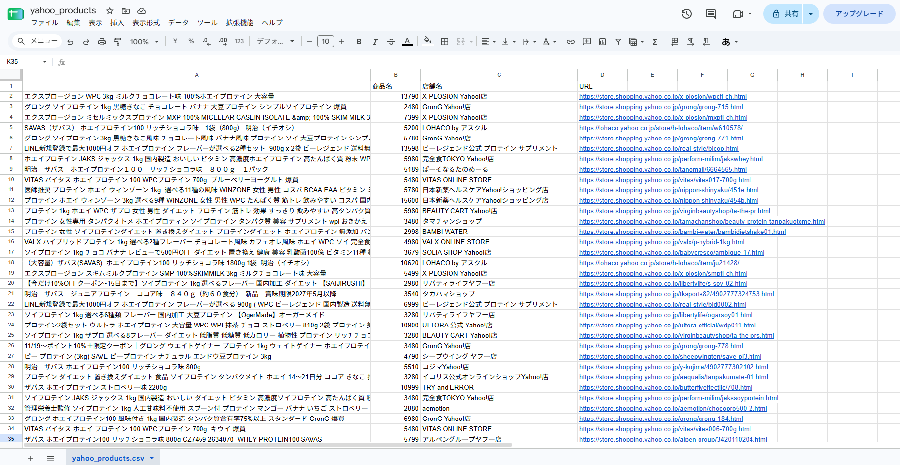

# Yahoo!ショッピング商品収集アプリ

## 概要

Yahoo!ショッピングAPIを利用して、指定したキーワードに関連する商品情報を取得し、CSVファイルに保存するPythonアプリケーションです。

学習・ポートフォリオ目的で作成しました。

※プロテインで検索した例:


## 使用技術

- Python
- requests
- pandas
- Yahoo!ショッピング商品検索API

## 主な機能

- キーワードによる商品検索
- 商品名・価格・店舗名・商品URLの抽出
- CSVファイルへの出力

## 設定項目

以下の項目を変更することで、取得条件を調整できます。

| 設定項目 | 内容 |
|---|---|
| KEYWORD | 検索キーワード |
| MAX_PAGES | 取得するページ数 |
| RESULTS_PER_PAGE | 1ページあたりの取得件数 |
| SLEEP_SECONDS | リクエスト間隔 |
| OUTPUT_FILE | 出力ファイル名 |

## APIの取得方法

本アプリケーションの実行には、Yahoo!ショッピングAPIのClient ID（アプリケーションID）が必要です。

以下の手順で取得できます。

1. [Yahoo!デベロッパーネットワーク](https://developer.yahoo.co.jp/)にアクセスする。
2. Yahoo! JAPAN IDでログインする。
3. アプリケーションを登録する。
4. 発行されたClient ID（アプリケーションID）を取得する。
5. 取得したClient IDをプログラムの設定箇所に入力する。

## 実行方法

### 1. 必要なライブラリをインストール

```bash
pip install requests pandas
```

### 2. APIアプリケーションIDを設定

Windows PowerShellの場合：

```powershell
$env:YAHOO_APP_ID="取得したアプリケーションID"
```

Windows PowerShellの場合：

```powershell
$env:YAHOO_CLIENT_ID="取得したClient ID"
```

Windows コマンドプロンプトの場合：

```cmd
set "YAHOO_CLIENT_ID=取得したClient ID"
```

macOS / Linuxの場合：

```bash
export YAHOO_CLIENT_ID="取得したClient ID"
```

### 3. プログラムを実行

```bash
python main.py
```

## 出力データ

取得した商品情報をCSV形式で保存します。

| 項目 | 内容 |
|---|---|
| 商品名 | 商品の名称 |
| 価格 | 商品価格 |
| 店舗名 | 販売店舗名 |
| URL | 商品ページのURL |

## 注意事項

- APIアプリケーションIDは環境変数に設定してください。
- APIの利用条件・制限に従って使用してください。
- Client IDは個人ごとに取得してください。
- Client IDは第三者に公開しないでください。